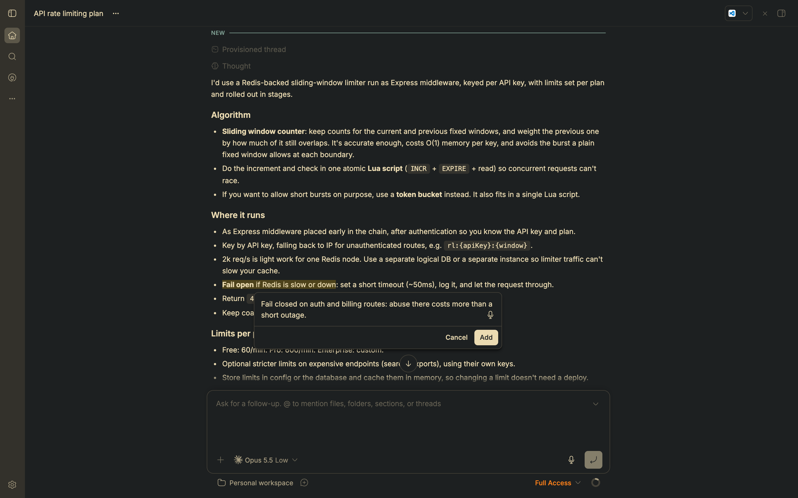
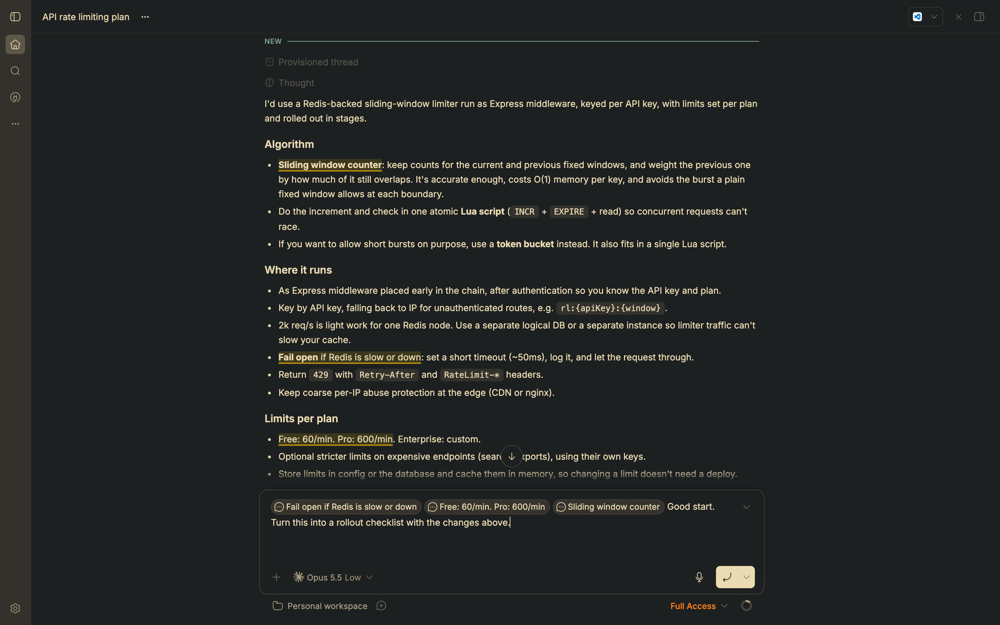
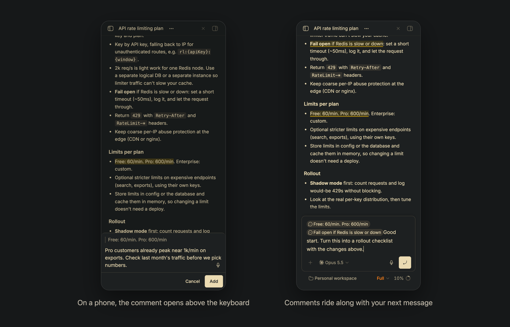

# Inline Comments for bb

Comment on exact passages of an agent's reply, the way Claude Desktop and ChatGPT let you: select text, choose **Add to chat**, and keep writing your message. Every comment goes to the agent with your next message, quoted next to the passage it refers to.







## Install

```sh
bb plugin install https://github.com/qwadrox/bb-plugin-inline-comments
```

Requires bb 0.46 or later. It needs no external service or account.

## How it works

- Select text in a message and choose **Add to chat**. A small card opens next to the selection; type or dictate your comment (bb's microphone appears in the field when voice input is set up) and press Enter.
- On a phone the card opens as a sheet above the keyboard, repeats the quoted passage, and Return adds a line: tap **Add** to save.
- The passage appears as a pill in the composer and stays highlighted in the transcript. Add as many as you like.
- Click a highlighted passage, or its pill in the composer, to edit or delete the comment.
- Write your overall feedback in the composer as usual. When you send, every pill goes with the message, and the agent receives each quoted passage with its comment.

Deleting a pill from the composer removes that comment from the message. This plugin's **Add to chat** replaces bb's built-in one, which only pastes the quote into the composer.

## Storage

Comment text is stored in this plugin's storage on your bb server and deleted a year after its last edit. Pending comments are the pills in a thread's draft, so they survive reloads like any draft.

## Development

```sh
npm install
npm run typecheck
bb plugin install .    # install from this checkout
bb plugin dev .        # rebuild and reload on every change
```

`PLUGIN_OVERVIEW.md` is the long-form description shown on the bb marketplace page.

## License

[WTFPL](LICENSE): do what you want with it.
